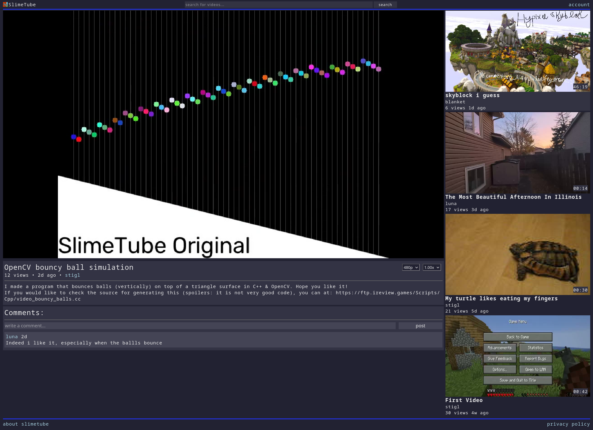

## SlimeTube
(or SlimyTube? SlimeyTube? I don't even know anymore)

Is a fast, flexible, self-hosted C++ video platform for user uploaded videos (ok, let's face it, its just a youtube clone).

### How to run

#### docker/podman
1. clone the repository **with --recursive**
2. `docker build --rm -t slimetube:latest .`
3. Place your certificates inside data/certs/ (server.crt and server.key) or disable https by removing it in data/config.json
4. Review `data/config.json` and make sure it matches your settings
6. To run: `docker run -it -d -p 8443:8443 -p 8080:8080 -v ./data:/data --name slimetube slimetube:latest`
   if you're using SELinux, you might need to add :z/:Z after the :/data (z - all containers can access it, Z - only this container can)

#### normally
1. clone the repository **with --recursive**
2. cd into the repository
3. install the following dependencies: `cmake make g++ c-ares-dev sqlite-dev jsoncpp-dev brotli-dev openssl-dev zlib-dev zstd-dev libuuid-dev ffmpeg-dev drogon` (drogon for drogon_ctl - can be installed using some package manager, you can also build from [source](https://drogon.org/))
4. `cmake -S . -B build -DCMAKE_BUILD_TYPE=Release`
5. `cmake --build build --config Release -j<number-of-threads>` (replace the <number-of-threads> with the number of threads your CPU contains - to find out on linux `nproc --all`)
6. To run: `./build/slimytube`

### Performance
SlimeTube is very fast. In my benchmarks(commit c2a77f5, conditions below), I was able to get **46991** requests per second on the `/` page with **p99 latency of 10.62ms** on a Alder Lake Intel Core i5-12400F  
How I benchmark slimetube:  
1. Increase the file descriptor limit for and run the server `prlimit --nofile=262140:262140 ./build/slimytube`  
2. Run benchmark via `prlimit --nofile=262140:262140 wrk --threads 4 --connections 200 --duration 10s --latency "http://127.0.0.1:8080/"`  

I was also able to get **30.62GBps** worth of video throughput(**29538 requests per second**) when repeatedly downloading a 1.1MiB video, so the video playback should not be a big problem either.  

### Configuration
For example values, see [data/config.json](./data/config.json)  
The settings inside "listeners", "db_clients", "app", "ssl" and "plugins" are drogon-specific - see [drogon docs](https://drogonframework.github.io/drogon-docs/#/ENG/ENG-11-Configuration-File) for more details for those.  
The setting "custom_config" contains all settings for this app specifically.  

- `title` - Title of the app (shows up in the website title and server response header)
- `url` - URL of the app (used for opengraph integration)
- `videos_dir` - directory for uploaded and encoded videos and thumbnails
- `salt_length` - length of user password salts(recommended atleast  16)
- `ffmpeg_log` - file where the log for ffmpeg output should go
- `ffmpeg_log_level` - how much ffmpeg should log
- `view_count_cache` - file where views that did not get written to the database get saved for when application is started
- `resolutions` - list of resolutions natively accepted by the encoder in format: `[[ratio_width, ratio_height], width, height, video_bitrate, [also]]` also: heights of other resolutions with the same ratio (defined below this one) that will also be encoded with this one - example: `[[16, 9], 1920, 1080, 3150000, [720]]` - where 1280x720 must be defined below this line
- `allow_unlisted_ratios` - whether to allow encoding of ratios not in the `resolutions` list
- `encoder_frame_rate` - what frame rate to encode all videos into
- `audio_bitrate` - what bitrate to use for videos
- `audio_sample_rate` - what sample rate to use for videos
- `use_embeded_pages` - which about and privacy page content should be used: false - static/about.html(+ privacy.html), true: views/about.csp(+ privacy.csp)
- `allow_anonymous_comments` - true allows not logged in users to post comments as Anonymous
- `allow_user_creation` - allows registering a new user on the website
- `max_search_results` - maximum number of items(users + videos, users first) that will be shown upon searching  
- `limits` - contains various limits on what the users are allowed to do on the platform
 

Below are the suboptions of `limits`:
- `max_blob_size` - how large of a file can a user submit to be encoded currently not used
- `total_user_size` - ~~how much space is a user allowed to use~~ currently not used
- `max_get_video_range_size` - maximum amount of video data the server will allow user to download with a http range request
- `max_unlisted_bitrate` - maximum bitrate an uploaded video will be encoded to
- `max_aspect_ratio` - maximum width/height multiplier for video to be encoded
- `max_input_video_width` - maximum width for a video to be encoded
- `max_input_video_height` - maximum height for a video to be encoded
- `max_encode_video_width` - maximum width for a video to be encoded to
- `max_encode_video_height` - maximum width for a video to be encoded to
- `max_recommended_previews_main` - maximum number of videos recommended to users on the index page
- `max_recommended_previews_watch` - maximum number of videos recommended to users on the watch page

### Endpoints
| URL                                                | Description                         | Headers/Query    | Success Codes | Error Codes | Authentication Required |
|----------------------------------------------------|-------------------------------------|------------------|---------------|-------------|-------------------------|
| POST `/api/user/register`                          | [API] create User                   | name, pass       | 201           | 400 409 500 | No                      |
| POST `/api/user/login`                             | [API] authenticate cookie           | name, pass       | 200           | 429         | No                      |
| POST `/api/user/logout`                            | [API] clear cookie                  |                  | 200           | 400         | Yes - 401 On fail       |
| DELETE `/api/user`                                 | [API] delete current user           |                  | 200           |             | Yes - 401 On fail       |
| POST `/api/user/name`                              | [API] change name                   | new_user         | 200           | 400 409     | Yes - 401 On fail       |
| POST `/api/user/password`                          | [API] change password               | new_pass         | 200           | 400 500     | Yes - 401 On fail       |
| POST `/api/video`                                  | [API] create video                  | title, desc      | 200           | 400         | Yes - 401 On fail       |
| DELETE `/api/video/<video_id>`                     | [API] delete video                  |                  | 200           | 403 404     | Yes - 401 On fail       |
| POST `/api/video/title/<video_id>`                 | [API] change video title            |                  | 200           | 403 404     | Yes - 401 On fail       |
| POST `/api/video/description/<video_id>`           | [API] change video description      |                  | 200           | 403 404     | Yes - 401 On fail       |
| GET `/rsc/thumbnail/<video_id>`                    | Get thumbnail image                 |                  | 200           |             | No                      |
| GET `/rsc/video/<video_id>`                        | Get chunk of video                  | Range            | 200 206       |             | No                      |
| PUT `/rsc/thumbnail/<video_id>`                    | Upload Thumbnail for processing     |                  |               |             | Yes - 401 On fail       |
| PUT `/rsc/video/<video_id>`                        | Upload chunk of video               | X-Last, X-Offset |               |             | Yes - 401 On fail       |
| POST `/register`                                   | create new user                     | name, pass       | 303           | 400 409 500 | No                      |
| POST `/login`                                      | authenticate cookie                 | name, pass       | 303           | 303 429     | No                      |
| POST `/logout`                                     | clear cookie                        |                  | 303           | 400 401     | Yes - 401 On fail       |
| POST `/user/delete`                                | delete user                         |                  | 303           | 401         | Yes - 401 On fail       |
| POST `/user/name`                                  | change username                     | new_user         | 303           | 400 409     | Yes - 401 On fail       |
| POST `/user/password`                              | change password                     | new_pass         | 303           | 400 500     | Yes - 401 On fail       |
| POST `/video/create`                               | create video                        | title, desc      | 303           | 400         | Yes - 401 On fail       |
| POST `/video/delete/<video_id>`                    | delete video                        |                  | 303           | 403 404     | Yes - 401 On fail       |
| POST `/video/title/<video_id>`                     | change video title                  | title            | 303           | 403 404     | Yes                     |
| POST `/video/description/<video_id>`               | change video description            | desc             | 303           | 403 404     | Yes                     |
| GET `/`                                            | recommendation page                 |                  | 200           |             | No                      |
| GET `/watch/{video_id}` and `/watch/?v=<video_id>` | watch page                          |                  | 200           | 404         | No                      |
| GET `/search/?q=<search_term>`                     | page of video search results        | q                | 200           |             | No                      |
| GET `/account`                                     | login and account managment page    |                  | 200           |             |                         |
| GET `/register`                                    | page for creating a new user        |                  | 200           |             | No                      |
| GET `/create`                                      | page for creating a video           |                  | 200           | 401         | Yes                     |
| GET `/video/upload/<video_id>`                     | upload video and its thumbnail      |                  | 200           | 403 404     | Yes                     |
| GET `/video/edit/<video_id>`                       | edit video properties               |                  | 200           | 403 404     | Yes                     |
| GET `/channel/<user_id>`                           | page with all videos made by a user |                  | 200           | 404         | No                      |
| POST `/comment/create`                             | create comment                      | video, content   | 303           | 400, 401    | Yes                     |
| POST `/comment/create/anonymous`                   | create comment(anonymous)           | video, content   | 303           | 400         | No                      |
